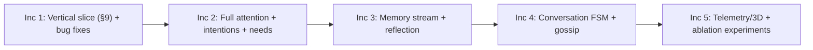

# PLAN ONLY — Humanlike Villager Architecture (Module M22-H)

> PLAN ONLY. No code written. Source: [AUTOGEN_Humanlike_Agent_Architecture.md](file:///c:/Users/Lenovo/Downloads/autogen/plan-docs/AUTOGEN_Humanlike_Agent_Architecture.md). Per `AGENTS.md` Step A, this is the plan to review before I build anything.

## 0. What I checked in the repo

| Fact | Evidence |
|---|---|
| Bug 1 is real: `affective_state` gets assigned twice, so the second line throws away `agent_id` | [villager_agent.py#L78-L79](file:///c:/Users/Lenovo/Downloads/autogen/packages/autogen/agents/village/villager_agent.py#L78-L79), and again in `reset()` at L804-805 |
| Bug 2 is real: the memory dedupe compares the raw `description` with stored `"[Step n] …"` strings, so it never matches | [villager_agent.py#L113-L116](file:///c:/Users/Lenovo/Downloads/autogen/packages/autogen/agents/village/villager_agent.py#L113-L116) |
| Memory is `tuple[str, ...]`, capped at 15 | `VillagerBeliefState.episodic_memories` |
| Controller phases 1–6 exist in `step()` | [controller.py#L326](file:///c:/Users/Lenovo/Downloads/autogen/packages/autogen/agents/village/controller.py#L326) |
| `VillageActionType` has 29 actions; none are reactive or social (no SHELTER/GREET/…) | [village_grid.py#L52](file:///c:/Users/Lenovo/Downloads/autogen/packages/autogen/simulation/environment/village/village_grid.py#L52) |
| `memory/episodic_memory.py` and `retrieval.py` exist, but villagers don't use them | `packages/autogen/memory/` |
| Baseline: `tests/unit/test_village_society.py` passes 13/13 | ran `pytest` just now |

## 1. Proposed delivery: 5 increments, each gated by your approval

**This approval covers Increment 1 only.** It's the doc's own "minimal vertical slice", and it already shows the four behaviors: heads turning to screams, staggered sheltering, greetings with mood contagion, and nightly grudge/fondness with evidence.

## 2. Increment 1: files

| File | New/Mod | Purpose |
|---|---|---|
| `intelligence/village/personality.py` | New | `Traits`, `PersonalityParams`, `weights_from_traits`, the 10 archetype trait vectors |
| `simulation/environment/village/events.py` | New | `Modality`, `WorldEvent`, `PerceivedEvent`, `WorldEventBus`, `WeatherProcess` |
| `intelligence/village/attention.py` | New | salience, habituation, attention budget, latency → `Alert` |
| `intelligence/village/intention.py` | New | `Intention`, commitment decay, `should_interrupt`, `u_react`, `C_switch` |
| `intelligence/village/relationships.py` | New | directed `(affinity, respect, familiarity)` store; `trust` stays in `VillageTrustGraph` |
| `intelligence/village/contagion.py` | New | synchronous PAD contagion pass |
| `intelligence/village/reflection.py` | New (minimal) | nightly `Disposition` (grudge/fondness/valence/confidence/evidence_ids) |
| `village_grid.py` | Mod | add `SHELTER`, `INVESTIGATE_NOISE`, `GREET`, and non-blocking `GAZE_AT` telemetry; `VillageObservation.percepts`; emit `CRY_OUT`/`ARRIVAL`/`THUNDER` |
| `villager_agent.py` | Mod | fix both bugs; Phase 2b attention; add `u_react − C_switch` in `evaluate_all_pathways` |
| `controller.py` | Mod | Phase 0 events, 2d contagion, 5c reflection, 7 telemetry; one `HumanlikeConfig` with an ablation toggle per layer |
| `affective_pad.py` | Mod | `AffectivePADConfig.contagion_gamma`; trait-derived baseline |
| `intelligence/registry.py` | Mod | register salience, contagion, intention arbitration, reflection |
| `docs/algorithms/village/{personality_mapping,salience_attention,intention_arbitration,emotional_contagion,reflection_dispositions}.md` | New | the 10-section algorithm docs required by AGENTS.md |
| `tests/unit/village/test_humanlike_*.py` | New | see §5 |

## 3. Math as I'll implement it

**Personality → weights** (doc §5.2, all traits in [0,1]):
$w_{soc}=14(0.7+0.6E)$, $w_{econ}=(0.8+0.4C)\,m_{role}$, $\kappa=18(0.8+0.5N)$,
$\theta_{risk}=\mathrm{clip}(0.25+0.35(O-.5)-0.30(C-.5)-0.25(A-.5)-0.20(N-.5),\,0.02,\,0.9)$.

**Salience** (§2.3): $S_i(p)=g_{mod}\,I\,e^{-d/L}\,(1-h_{kind})\,(1+R_i)\,(1+A_i^{+})\cdot G_{trait}$, with $L=6$ tiles. Thunder uses prox = 1. Thresholds: notice 0.25, alert 0.55, startle 1.1. Budget is 2 alerts per tick. Habituation is $h\leftarrow h+0.3(1-h)$ on a repeat and $h\leftarrow 0.9h$ per tick otherwise.

**Interruption** (§2.5): interrupt when $S(1+\text{threat}) > c\,(1+0.4C) + 0.3\cdot\mathbb 1[\text{prog}>0.8] + 0.15$.
Utility: $U'(a)=U(a)+\lambda_{att}\,u_{react}(a)-\kappa_{sw}\,c\,\mathbb 1[a\notin I]$.

**Contagion** (§3.4, synchronous): $\Delta P_i=\gamma_i\sum_j w_{ij}(\tilde P_j-P_i)$, with $w_{ij}=e^{-d/L}(0.5+0.5\,\text{aff}_{ij})\,\text{attn}_{ij}$. Negative sources get ×1.3. Total input per tick is capped at 0.15 per axis.

**Reflection** (§4.4): $v\leftarrow 0.85v+0.15\bar v$, $g\leftarrow\mathrm{clip}(g+0.6\,\text{harm}-0.4\,\text{help}\cdot\mathbb 1[g>0])$, $\text{conf}=1-e^{-0.4n}$. Grudges decay each tick by $\min(0.999,\ 0.995+0.004N-0.003A)$.

## 4. Where I'd change or settle the blueprint

1. **Seeding. The doc's version would break determinism.** It proposes `random.Random(seed ^ hash(agent_id))`, but Python's `hash()` of a string is salted per process. I'll use `SeedSequence.spawn` with named streams per agent instead (`humanlike/<agent_id>/gossip`, …), which is what AGENTS.md requires.
2. **§5.3 prepotency.** The doc has a self-correction in it. I'll use $g_k=\prod_{j<k}\text{sat}_j^{0.7}$.
3. **Contagion γ.** §3.4 and §5.2 give different formulas. I'll use the §5.2 one: $0.08(0.6+0.4E+0.4A)$.
4. **`openness_inverse`** isn't defined in the doc. I'll take it as $1-O$ (Increment 4).
5. **Weather source of truth. This is a contract change.** Today weather lives only in the browser (`setW`). For agents to perceive thunder, the backend has to own weather. The frontend buttons would then call the API, and 3D would render what the backend reports. That changes `docs/architecture/data_contracts.md`, so it needs your OK.
6. **Telemetry payload. Also a contract change.** It's additive: each villager gets new `gaze`, `alert_level`, `emote`, `intention`, `thought`, and `relationships` fields. Nothing existing is removed.
7. **Canonical hash.** The new agent state gets included in the hash. The test checks "same seed → same hash", not "same hash as before": trajectories will change on purpose.
8. **Utility scale.** I'll log per-term contributions and set $\lambda_{att}$ and $\kappa_{sw}$ (starting at 4 and 3) so that no new term drives more than 60% of decisions. Those values aren't fixed yet; I'll report the calibration data.

## 5. Verification plan (independent oracles)

| Algorithm | Invariant / oracle |
|---|---|
| Personality map | each weight is monotonic in its trait (property test over a grid); stays within bounds |
| Salience | hand-computed values for the doc's thunder walkthrough; zero novelty ⇒ zero salience; budget never exceeded |
| Intention | no oscillation: switches per agent per 20 ticks ≤ 4; a high-N agent reacts no later than a low-N/high-C agent (paired seeds) |
| Contagion | order-independent (shuffled agent order ⇒ identical PAD); with γ=0 matches the old ODE exactly; with no further stimuli, PAD → baseline |
| Reflection | robbed 3× by the same culprit ⇒ grudge > 0.6 with 3 evidence ids; memory stays bounded |
| End-to-end | thunder ⇒ ≥70% of outdoor agents change intention within 2 ticks (mean over 20 seeds); same seed ⇒ same hash; all ablations off ⇒ the old 13 tests still pass |
| Regression | full `pytest`, `ruff`, `mypy`, and `npm run build` |

## 6. Risks

- **Jitter** from salience spikes. Mitigated by hysteresis plus $C_{switch}$, with the oscillation bound as a test.
- **Panic cascades.** Mitigated by the contagion cap and decay dominating at long horizons, with a test.
- **The existing 13 tests may assume old trajectories.** If any fail with the layers on, I'll find the root cause. I won't weaken tests (B.2 rule 6).
- **Merge conflicts in the 3D frontend.** Increment 1 adds only the backend telemetry. The 3D gaze/emote rendering lands in Increment 5.

## 7. Acceptance criteria for Increment 1

1. Both bugs fixed, each with a regression test.
2. All new modules are typed and registered, with complete `docs/algorithms/village/*.md`.
3. Every §5 test passes; raw output shown; full suite, ruff, and mypy green.
4. A CLI demo `python -m autogen.examples.humanlike_village_demo --seed 42` prints a thunderstorm: per-agent salience, interrupt decisions, shelter timing, greetings, and nightly dispositions with evidence ids.
5. `DecisionTrace.rationale` gains `alerts`, `u_react`, `c_switch`, and `intention`, all generated from actual execution.
